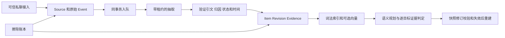

# N01 记忆重构审计与验证记录

基线为本地发布候选 `dc5d17c66ce261585e0673c7788937bd980d1e90`。本地 `origin/main` 为 `c7d49588e97cd52158a48fadaaddf5e0e56bae2f`，候选领先 8 个提交。GitHub API 确认远端 main 与该 SHA 一致，远端发布候选为 dc5d17c。历史 Windows 和 Ubuntu Actions 失败见 [1e7628c 的流水线](https://github.com/WhiteApricot/Fat-Fish-Assistant/actions/runs/45386985439)。隔壁 N01 工作区包含已有未提交改动，本轮使用发布候选 checkout 的独立分支 `feat/ffa-n01-memory-architecture`。

## 正式调用链审计

| 环节 | 发布候选中的实际调用路径 |
| --- | --- |
| 接入与记录 | `PlatformGateway._run → GatewayBridge.prepare → _record_chat → MemoryService.record`，定时任务和回复后的维护负责处理待分析来源。 |
| 长期归纳 | `GatewayBridge._run_analysis → projections.ready_batches/claim → reasoner.analyze[_batch] → projections.apply`，形成事实、互动信号、卡片等投影。 |
| 检索注入 | `fat_fish_guard.add_scoped_memory → GatewayBridge.augment → MemoryService.context + projections.snapshot`。在注入前比较旧库擦除 epoch，并复核当前记忆权限。 |
| 正式检索边界 | E/Eprev 由独立 `EventRetrieval` 和实验运行器调用。其事件语义入口仍使用正则及固定词组。Gateway 的正式聊天入口未调用该类。 |
| 权限与删除 | `GatewayBridge._access` 在接入后授予 Principal 或群作用域。平台撤回经 `PlatformGateway.retract` 写旧库撤回记录并清除派生项。旧库发送路径检查当前平台接入、消息撤回及会话，但缺少对知识快照修订的完整核验与再生成。 |
| 候选认知库 | `MemoryRepository` 管理 WAL、授权证据过滤、版本、派生索引和独立擦除日志。`CognitiveMemoryGateway` 与 `ProtectedReply` 已有独立定向回归，尚未替代 `GatewayBridge`。 |

发布候选的旧库仍服务命令、记忆开关、原始来源、公开经历、画像、卡片和回复。其隐私、撤回、公开来源、跨平台绑定及故障隔离回归仍有价值。E/Eprev 正则以及旧 Gold 只适用于历史比较。现有 [E/Eprev 实验报告](../research/FFA_COGNITIVE_RETRIEVAL_REPORT.md) 已记录扩池后可能出现其他合理答案和 v2 缺少 Episode 标签。

## 本次实现



- `CognitiveMemoryGateway.capture_inbound` 在一次 SQLite 事务写入私聊来源、原始事件、任务及任务输入。任务由数据库租约领取，可在进程恢复后重试。重复来源不创建重复任务。提交修订、证据、词法索引和任务完成标记发生在同一事务。
- `structured_memory` 校验受限的模型 JSON、来源中的逐字引文、直接提及的名称、日期格式和实际发生时间的适用状态。用户陈述保留用户报告的归因，模型的提议不生成可信 Bot 回执。名称和 Episode 提及是修订元数据，当前没有跨消息消歧与归并。
- `semantic_snapshot` 由调用方选择是否发送显式历史回想到语义模型。查询规划从对话和原问句拆分检索目标，词法和可选向量分别召回，每个目标均须在授权候选内选择证据。调用方可直接使用 `CognitiveRetrieval.recall` 的词法快路径。新的认知快慢路径不根据固定问句关键词路由。
- 回复保留证据 ID、修订、内容摘要、作用域代次、授权版本和会话历史版本，由 `ProtectedReply` 在交付时复核。旧草稿失效后可在模拟传输重新构建请求。SQLite 词法授权快照使用 WAL 并拒绝与擦除账本重放重叠的读。
- 新路径复用已有 `source/event/job/job_input/item/revision/evidence/search_doc/posting` Schema。事件的 `occurred_at` 字段用于原始活动的发生时间，模型提取到的历史发生日期另存在修订 JSON。事实的生效区间和系统写入时间分开。新的查询仍主要提供当前修订召回，完整双时间查询仍待实现。

架构取舍来自 Graphiti 对边的有效时间、失效时间和记录时间的拆分，Mem0 的词法、语义和实体信号，以及 Honcho 的观察者与被观察者区分。这里采用 SQLite 和本地事务，新代码为 FFA 实现。[Graphiti 边实现](https://raw.githubusercontent.com/getzep/graphiti/main/graphiti_core/edges.py) · [Mem0 存储实现](https://raw.githubusercontent.com/mem0ai/mem0/main/mem0/memory/main.py) · [Honcho 数据模型](https://raw.githubusercontent.com/plastic-labs/honcho/main/src/models.py)

现有研究文档记录 Hindsight 的召回编排及 OpenClaw 的快慢路由。Letta 官方资料区分常驻核心记忆、按需归档召回与会话历史，和 FFA 的按需深度查询方向一致。Hindsight、OpenClaw 的固定提交源码直连本轮未能读取，Letta 执行器源码复核也未完成。[FFA 项目研究记录](../research/FFA_COGNITIVE_RETRIEVAL_RESEARCH.md) · [Letta 记忆架构](https://github.com/letta-ai/skills/blob/main/letta/agent-development/references/memory-architecture.md)

## 复现

从仓库根目录把 `src` 放入 `PYTHONPATH`，执行以下命令。Windows 并发基准使用 `psutil` 采样 RSS，Linux 使用 Python 标准库。基准只创建一次性合成 SQLite 数据。

```text
python -B -m unittest discover -s tests -p test_structured_memory_flow.py -v
python -B -m unittest discover -s tests -q
python -B diagnostics/benchmark_structured_memory.py
```

## 独立评测接口

冻结评测由保管方按故事、会话或主体切分。保管方记录标签文件 SHA-256，在开发者无样例访问权限的环境中执行推理并保存预测。标签和预测均是 JSON 数组，使用同一个不透明的 `id`。标签携带 `decision`、`gold`、`hard_negatives`，预测携带 `decision`、`candidate_pool`、`ranked`、`support`。字段中的证据 ID 必须与各自评测故事的来源标识一致。

`diagnostics/score_memory_recall.py` 接收 `--labels`、`--labels-sha256` 和 `--predictions`，输出哈希、样本数、汇总质量及首要失败类别。脚本不会输出题目、Gold 或逐题预测。包含 Recall@1/3/5/10、Hit@K、Precision@K、MRR、nDCG@5、证据完整率与精确集合命中率、决策指标和难负例错误采纳。排序和召回指标按可答题宏平均，难负例按有此类标注的题目计算。首要失败类别依次检查候选缺失、排序截断、决策和证据组合。缺少对应类样本时，指标输出 JSON null。评分器的开发夹具已通过，仍需保管方提供独立标签与冻结推理流水线。

## Windows 模拟

Python 3.12.3 离线发现 248 项，218 项通过、30 项因缺少固定 AstrBot 环境跳过，用时 65.986 秒。语法及 Git 空白检查通过。Windows 回环和擦除账本锚点需要在应用沙箱外运行。

以下每个规模执行 120 次词法查找，4 个读线程与 1 个写线程并发，后台写入为 100 次原始消息与持久抽取任务的同事务写入。命中指返回中含唯一设备标识。表中的读分位数包含失败查询，库大小包含存在的 WAL 等文件。

| 合成记忆数 | 词法 P50 / P95 / P99 | 写入 P50 / P95 / P99 | 读取错误 | 写入错误 | 标识命中 | 平均候选 | 峰值采样 RSS | SQLite 文件 |
| ---: | --- | --- | ---: | ---: | ---: | ---: | ---: | ---: |
| 1,000 | 19.29 / 61.98 / 64.78 ms | 21.11 / 32.70 / 35.72 ms | 0 | 0 | 120/120 | 12.0 | 35.5 MiB | 1.46 MiB |
| 10,000 | 29.39 / 64.23 / 97.53 ms | 19.48 / 35.78 / 41.72 ms | 1 | 0 | 119/120 | 11.9 | 36.4 MiB | 11.91 MiB |
| 50,000 | 35.90 / 96.60 / 104.65 ms | 23.69 / 48.92 / 68.95 ms | 2 | 0 | 118/120 | 11.8 | 36.6 MiB | 60.49 MiB |

三个规模的并发运行 CPU 用时依次为 0.641、0.969 和 1.625 秒。结果适用于合成索引和原始捕获。模型抽取和生成、实体关联性能、持续撤回争用和完整聊天 4–6.5 秒目标仍无可用计时。

另一次 Windows 串行混合召回中，使用本机 llama.cpp 双线程与 BGE-small-zh-v1.5 GGUF，在合成库的 10,000 条记忆中为 24 条建向量索引，再执行 24 条不同的未缓存查询。全部 24 次模型推理成功，模型 HTTP 累计 640 ms，混合召回 P50/P95/P99 为 47.03/57.29/57.82 ms，24/24 命中设备标识。计时包含真实查询 embedding 和 SQLite 检索，未包含 LLM 规划、证据判断和聊天生成。耗时样本数较小，向量索引覆盖有限，进程 RSS 不包括独立模型进程。可用 `--sizes 10000 --embedding-url http://127.0.0.1:PORT/v1` 复现，需预先启动对应的独立 BGE 实例。

## Ubuntu WSL2 模拟

Python 3.12.3，Linux 原生临时目录，CPU 亲和性限制为 2 核，进程虚拟地址空间上限 4 GiB。新增 4 项定向回归均通过，用时 26.972 秒，包含跨端同主体回忆、过期任务拒绝写入、引文和时间校验、并发撤回后丢弃读取快照。未运行完整 Linux 离线套件。

| 合成记忆数 | 读取/写入样本 | 词法 P50 / P95 / P99 | 写入 P50 / P95 / P99 | 读/写错误 | 命中 | RSS | SQLite 文件 |
| ---: | ---: | --- | --- | ---: | ---: | ---: | ---: |
| 1,000 | 120 / 100 | 5.09 / 10.43 / 13.01 ms | 1,211.62 / 2,145.29 / 2,765.39 ms | 0 / 0 | 120/120 | 34.4 MiB | 1.46 MiB |
| 10,000 | 12 / 12 | 5.91 / 14.99 / 14.99 ms | 2,187.00 / 6,606.89 / 6,606.89 ms | 0 / 0 | 12/12 | 34.3 MiB | 11.88 MiB |
| 50,000 | 12 / 12 | 4.78 / 16.99 / 16.99 ms | 1,309.77 / 1,771.71 / 1,771.71 ms | 0 / 0 | 12/12 | 34.7 MiB | 60.45 MiB |

各档均为 4 个读线程、1 个写线程，平均候选数 12。并发部分 CPU 分别为 0.606、0.078、0.069 秒。首次三档测试仅返回 1,000 条结果，会话随后退出。后两档以 `--seed-batch 10000 --samples 12` 单独复跑，P95 和 P99 都是这些小样本的最大值。持久捕获存在秒级长尾，1 万档的单次写入已耗尽 6.5 秒预算。测试尚未区分调度、提交和底层存储时间，也未测 Linux 真实 BGE 或完整聊天。低配延迟未验收。

## 验收边界

目前属于部分实施。正式入口切换、旧代码清理、Observation 证据聚合、实体关系和多轮 Episode 管理、语义冲突演化、历史时间查询，以及真实 embedding 后台构建均未完成。重复语义键目前是结构内容摘要，只消除完全等价的结构记录，原第一来源被撤回时可能丢失仍有第二条佐证的条目。模型逐字引文验证可发现虚构引文，不能独立证明引文支持归纳。语义决策是模型输出，验证保证它只能选择当前候选池中的记录，理解质量需要独立测量。

新增测试属于开发集，固定模型输出仅用于验流程。独立 Gold、按故事切分的开发集/验证集、外部保管的冻结盲测、质量消融和完整生成性能都没有可报告成绩。历史 E/Eprev 分数没有纳入本轮通过率。无发布或合并依据。

